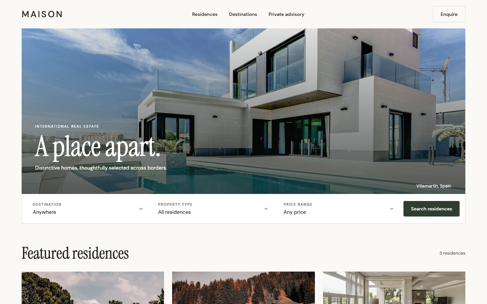
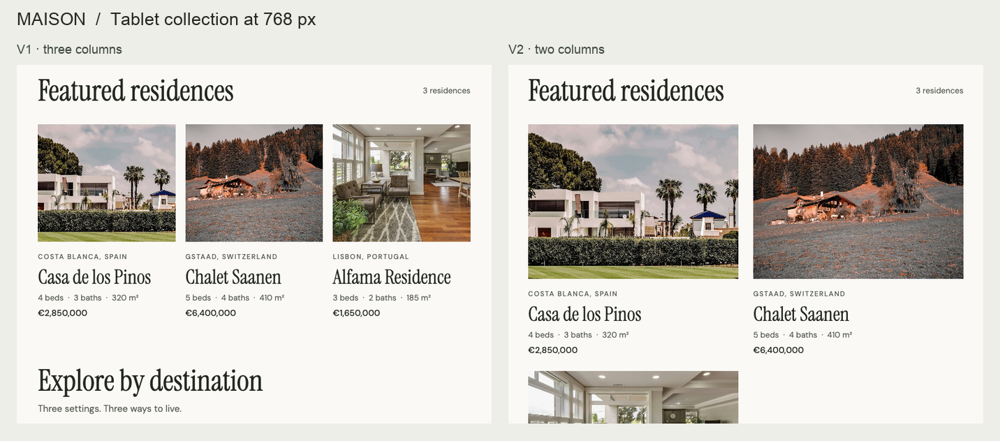

# MAISON — Design to Code

MAISON is an English-language real estate prototype with three fictional residences in Costa Blanca, Gstaad and Lisbon. Visitors can filter the collection, open a property, browse by destination and prepare a downloadable enquiry brief. The app runs locally and keeps the brief on the visitor’s device.



## Study objective

The assignment compares two implementations of the same landing page. Both use the same content, photographs, fonts, tools and generation brief. V2 adds semantic variables, responsive sizing, state variants and a tablet reference. The frozen V1 source is available at the `v1-baseline` tag.

[Editable Figma file](https://www.figma.com/design/ogOOwc2oKmdtGASQ8u9yyR) · [Final PDF report](report/MAISON-Design-to-Code.pdf) · [Bilingual defense](DEFENSE.md) · [Photography credits](PHOTOGRAPHY.md)

| Figma page | What to open |
|---|---|
| 01_Design_V1 | [Desktop](https://www.figma.com/design/ogOOwc2oKmdtGASQ8u9yyR?node-id=5-3) · [Mobile](https://www.figma.com/design/ogOOwc2oKmdtGASQ8u9yyR?node-id=5-100) |
| 02_Design_V2 | [Desktop](https://www.figma.com/design/ogOOwc2oKmdtGASQ8u9yyR?node-id=8-102) · [Tablet](https://www.figma.com/design/ogOOwc2oKmdtGASQ8u9yyR?node-id=8-451) · [Mobile](https://www.figma.com/design/ogOOwc2oKmdtGASQ8u9yyR?node-id=8-286) |
| 03_Design_System | [Color, type, spacing, radius, states, cards and section masters](https://www.figma.com/design/ogOOwc2oKmdtGASQ8u9yyR?node-id=10-161) |
| 04_Comparison | [Screenshot boards](https://www.figma.com/design/ogOOwc2oKmdtGASQ8u9yyR?node-id=13-102) · [Measurement table](https://www.figma.com/design/ogOOwc2oKmdtGASQ8u9yyR?node-id=14-102) |
| 05_Reverse_MCP | [Native import of the running V2 website](https://www.figma.com/design/ogOOwc2oKmdtGASQ8u9yyR?node-id=11-2) |

## Run the websites

Both apps use React 19, TypeScript, Tailwind CSS 4 and Vite 7. The project was built with Node 24.13.0. Use Node 22.12+ or a compatible newer LTS with npm. Each version has its own lockfile.

Run V1 from the repository root in one terminal.

```sh
cd version-1
npm ci
npm run dev -- --host 127.0.0.1 --port 5177 --strictPort
```

Run V2 from the repository root in another terminal.

```sh
cd version-2
npm ci
npm run dev -- --host 127.0.0.1 --port 5178 --strictPort
```

Open [V1 locally](http://127.0.0.1:5177/) or [V2 locally](http://127.0.0.1:5178/). In either app directory, `npm run build` checks TypeScript and creates the production bundle. `npm run preview` serves that bundle.

With both development servers running and Google Chrome installed, reproduce the recorded browser checks from the repository root. These commands refresh each version’s browser screenshots and measurement JSON.

```sh
cd qa
npm ci
npm run verify -- 1
npm run verify -- 2
```

## Figma MCP in VS Code

1. Open this repository as a workspace. Its [.vscode/mcp.json](.vscode/mcp.json) declares a server named `figma` with HTTP transport and the official endpoint `https://mcp.figma.com/mcp`.
2. Install or enable GitHub Copilot and Copilot Chat, sign in to GitHub and select Agent mode. Start Figma from the workspace MCP configuration or the MCP server list.
3. Complete Figma’s browser authorization using the account that can access the design. In the chat input, type `#get_design_context`, select the Figma tool and supply a frame link from the table above.
4. For the recorded check, open the V2 desktop frame and ask for the headline and all three residence names. Expand the tool card and verify that the input is node `8:102`. Compare the answer with the visible text in Figma.

**Verified in VS Code 1.148.0.** GitHub Copilot called Figma’s `get_design_context` for the V2 desktop frame. It returned “A place apart.” and all three residence names in order: Casa de los Pinos, Chalet Saanen and Alfama Residence. The original attempt on VS Code 1.104.1 returned `model_not_supported`. Screenshots document both attempts. The design context, layout metadata, variables and reference screenshots used to build V1 and V2 came from the official Figma connector in Codex. [Expanded tool input](screenshots/mcp-setup/06-vscode-tool-input.png) · [Completed chat response](screenshots/mcp-setup/05-vscode-copilot-result.png) · [Exact verification prompt and result](report/mcp/vscode-verification.txt)

[VS Code setup screenshots](screenshots/mcp-setup) · [MCP response excerpts](report/mcp) · [Figma MCP catalog](https://www.figma.com/mcp-catalog/) · [VS Code setup guide](https://help.figma.com/hc/en-us/articles/39890361040535-VS-Code-and-Figma-Set-up-the-MCP-server) · [Remote server guide](https://help.figma.com/hc/en-us/articles/35281350665623) · [Official MCP repository](https://github.com/figma/mcp-server-guide)

## Results

| Measured outcome | V1 | V2 |
|---|---:|---:|
| Desktop page height, design and browser | 1901 px | 1901 px |
| Mobile page height, design and browser | 3233 px | 3233 px |
| Desktop H1 element width in Chrome | 1252 px | 371.23 px |
| Hero location caption’s right inset | 54 px | 42 px |
| Width of the Figma main frame after a parent resize to 1024 px | 1440 px | 1024 px |
| Tablet property grid at 768 px | 3 × 222.55 px | 2 × 340 px |
| Source desktop component instances | 18 | 20 |
| Desktop context entries for colors and numeric variables | 7 | 27 |
| Desktop pixels within the RGB tolerance | 95.22% | 95.25% |
| Mobile pixels within the RGB tolerance | 93.11% | 93.15% |

The full-page pixel check compares images at native resolution. A pixel passes if the absolute difference in **every** RGB channel is at most 12 on the 0–255 scale. The headline’s text span measures 371.23 px in both browsers. V2 corrects the stretched element box, a caption offset and an extra button outline. Its largest layout change is on tablet. This study combines design improvements with implementation review, so it cannot assign separate effects to naming, variables or Auto Layout.



Both builds passed TypeScript, Vite and automated interaction checks at 320, 390, 768 and 1440 px. The runs captured zero page or console errors. The reverse import contains 86 nested frames and 43 editable text layers. Seventy-three frames use Auto Layout. The original component instances were lost in conversion, and the search chevrons shifted left.

[Full six-column comparison](report/COMPARISON.md) · [Screenshot pairs](screenshots/comparison) · [Browser V1 measurements](report/browser-v1.json) · [Browser V2 measurements](report/browser-v2.json) · [RGB results](report/image-comparison.json) · [Reverse layer audit](report/reverse-layer-audit.json)

## Deliverables and provenance

| Directory | Contents |
|---|---|
| version-1, version-2 | Independently runnable apps with local photographs and packaged fonts |
| screenshots | Figma exports, website renders, VS Code evidence, comparisons and reverse import |
| prompts | Original assignment and exact working briefs with frame targets |
| report | Twelve-page English PDF, six-column table, raw measurements and connector excerpts |
| qa | Reproducible Chrome interaction and layout checks |
| DEFENSE.md | Eighteen defense questions with English and Russian answers |

Codex authored the Figma layouts and React code, used the official MCP tools, performed browser checks and prepared the analysis. V2 reuses the tested sample-data and interaction behavior while adapting the layout and component boundaries to the revised source. The photographs are credited individually. The app’s listings, names and prices are illustrative.
